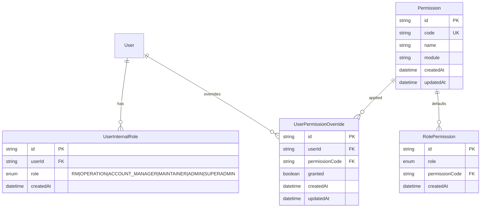
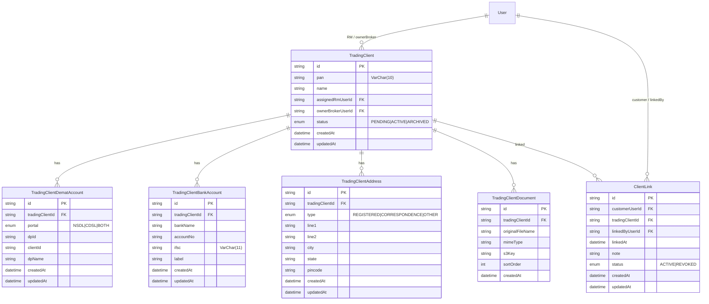
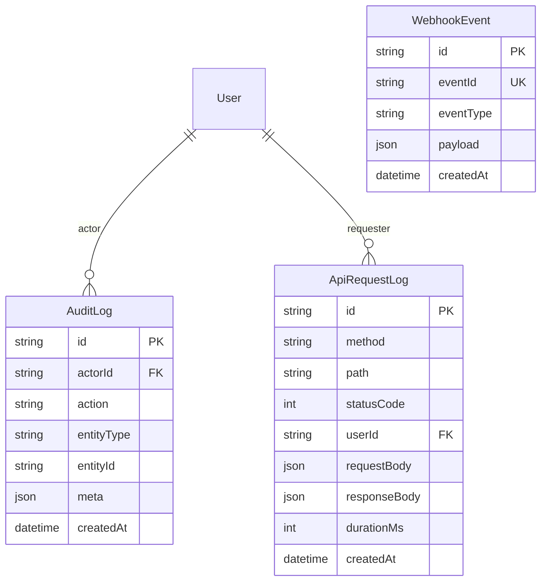

# Dhankirti Platform — Database ERD & Schema Reference

> **Source of truth:** [`prisma/schema.prisma`](../prisma/schema.prisma)  
> **Database:** PostgreSQL · **ORM:** Prisma 6 · **IDs:** `cuid()` (default)

This document contains the full entity-relationship diagram and every table attribute for the unified Dhankirti platform database.

---

## Table of contents

1. [Design overview](#1-design-overview)
2. [Full database diagram (all tables)](#2-full-database-diagram-all-tables)
3. [Domain ERDs (with attributes)](#3-domain-erds-with-attributes)
4. [Enums reference](#4-enums-reference)
5. [Tables & attributes (complete)](#5-tables--attributes-complete)
6. [How to view / export diagrams](#6-how-to-view--export-diagrams)

**Legend:** PK = primary key · UK = unique · FK = foreign key · `?` = nullable

---

## 1. Design overview

The schema supports three portals (customer, broker, internal) on one database:

| Domain | Purpose |
|--------|---------|
| **Users & auth** | Login accounts, profiles, tokens, OTP |
| **RBAC** | Permissions, internal roles, per-user overrides |
| **Trading clients** | Demat/PAN identity for desk ops (may exist without portal login) |
| **Catalog** | Companies, inventory, deals |
| **Orders & money** | Buy/sell orders, payments, share settlement |
| **Customer portal** | KYC, portfolio, sell requests |
| **System** | Webhooks, audit logs, API request logs |

**Total models:** 39 tables

---

## 2. Full database diagram (all tables)

High-level ERD showing every table and relationship. Open in [Mermaid Live Editor](https://mermaid.live) to export PNG/SVG.

```mermaid
erDiagram
  %% ── Users & Auth ──
  User ||--o| CustomerProfile : has
  User ||--o| StaffProfile : has
  User ||--o| BrokerProfile : has
  User ||--o| KycProfile : has
  User ||--o{ UserInternalRole : has
  User ||--o{ UserPermissionOverride : has
  User ||--o{ AuthToken : has
  User ||--o{ UserRefreshToken : has
  User ||--o{ UserOtp : has
  User ||--o{ PortfolioHolding : holds
  User ||--o{ SellRequest : creates
  User ||--o{ AuditLog : acts
  User ||--o{ ApiRequestLog : requests
  User ||--o{ ClientLink : "customer/linker"
  User ||--o{ TradingClient : "RM/broker"
  User ||--o{ Order : "customer/broker/actors"
  User ||--o{ Deal : "create/approve/target"
  User ||--o{ User : assignedRm

  Permission ||--o{ RolePermission : defaults
  Permission ||--o{ UserPermissionOverride : overrides

  %% ── Trading Clients ──
  TradingClient ||--o{ TradingClientDematAccount : has
  TradingClient ||--o{ TradingClientBankAccount : has
  TradingClient ||--o{ TradingClientAddress : has
  TradingClient ||--o{ TradingClientDocument : has
  TradingClient ||--o{ ClientLink : linked
  TradingClient ||--o{ Order : desk

  %% ── Catalog ──
  Company ||--o| CompanyOwnership : has
  Company ||--o{ CompanyFinancial : has
  Company ||--o{ CompanyNews : has
  Company ||--o| Inventory : has
  Company ||--o{ InventoryMovement : moves
  Company ||--o{ Deal : offers
  Company ||--o{ Order : traded
  Company ||--o{ PortfolioHolding : held
  Company ||--o{ SellRequest : optional

  Deal ||--o{ Order : generates

  %% ── Orders ──
  SellRequest ||--o| Order : becomes
  Order ||--o{ OrderStatusHistory : history
  Order ||--o{ PaymentLine : payments
  Order ||--o{ ShareSettlementLine : settlement
  Order ||--o| InventoryMovement : stockChange

  %% ── KYC ──
  KycProfile ||--o| KycPanVerification : pan
  KycProfile ||--o| KycAadhaarVerification : aadhaar
  KycProfile ||--o| KycBankAccount : bank
  KycProfile ||--o| KycDematAccount : demat
  KycProfile ||--o{ KycDocument : docs
  KycProfile ||--o{ KycBankVerificationAttempt : attempts

  User {
    string id PK
    string email UK
    enum roleType
    enum publicRole
  }

  Company {
    string id PK
    string isin UK
    string name
  }

  Deal {
    string id PK
    enum type
    enum status
  }

  Order {
    string id PK
    enum channel
    enum side
    enum status
  }

  TradingClient {
    string id PK
    string pan
    enum depository
  }

  KycProfile {
    string id PK
    enum status
  }

  Inventory {
    string id PK
    int totalStock
  }

  Permission {
    string id PK
    string code UK
  }

  WebhookEvent {
    string id PK
    string eventId UK
  }
```



---

## 3. Domain ERDs (with attributes)

### 3.1 Users & authentication

```mermaid
erDiagram
  User ||--o| CustomerProfile : "1:1"
  User ||--o| StaffProfile : "1:1"
  User ||--o| BrokerProfile : "1:1"
  User ||--o{ AuthToken : has
  User ||--o{ UserRefreshToken : has
  User ||--o{ UserOtp : has
  User ||--o{ User : assignedRm

  User {
    string id PK
    string email UK
    string passwordHash
    enum roleType "PUBLIC|INTERNAL"
    enum publicRole "CUSTOMER|BROKER?"
    string mobile UK
    boolean emailVerified
    datetime passwordSetAt
    string assignedRmUserId FK
    boolean isActive
    string legacyPlatformId UK
    datetime createdAt
    datetime updatedAt
  }

  CustomerProfile {
    string id PK
    string userId FK_UK
    string name
    enum accountType "INDIVIDUAL|COMPANY"
    datetime createdAt
    datetime updatedAt
  }

  StaffProfile {
    string id PK
    string userId FK_UK
    string name
    string department
    datetime createdAt
    datetime updatedAt
  }

  BrokerProfile {
    string id PK
    string userId FK_UK
    enum mode "INDEPENDENT|RM_ATTACHED"
    string assignedRmUserId FK
    enum status "PENDING|APPROVED|SUSPENDED"
    datetime createdAt
    datetime updatedAt
  }

  AuthToken {
    string id PK
    string userId FK
    string tokenHash
    enum purpose "PASSWORD_RESET|INVITE"
    datetime expiresAt
    datetime usedAt
    datetime createdAt
  }

  UserRefreshToken {
    string id PK
    string userId FK
    string tokenHash
    datetime expiresAt
    datetime revokedAt
    datetime createdAt
  }

  UserOtp {
    string id PK
    string userId FK
    string otpHash
    enum purpose "LOGIN|REGISTER_USER"
    datetime expiresAt
    datetime verifiedAt
    int attemptCount
    datetime createdAt
  }
```

### 3.2 RBAC



**Unique constraints:** `(userId, role)` · `(role, permissionCode)` · `(userId, permissionCode)`

### 3.3 Trading clients



**Unique constraints:** `(pan, depository)` · `(tradingClientId, sortOrder)` · `(customerUserId, tradingClientId)`

### 3.4 Catalog — company, inventory, deal

```mermaid
erDiagram
  Company ||--o| CompanyOwnership : "1:1"
  Company ||--o{ CompanyFinancial : has
  Company ||--o{ CompanyNews : has
  Company ||--o| Inventory : "1:1"
  Company ||--o{ InventoryMovement : audit
  Company ||--o{ Deal : offers
  User ||--o{ Deal : "target/create/approve"
  Order ||--o| InventoryMovement : optional

  Company {
    string id PK
    string isin UK
    string name
    string logo
    text about
    string_arr categories
    string valuationCr
    string website
    string headquarter
    string foundedYear
    string fundingStage
    text investmentHighlights
    json financialChart
    enum shareTransferDepository "NSDL|CDSL|BOTH"
    boolean isActive
    string legacyPlatformId UK
    datetime createdAt
    datetime updatedAt
  }

  CompanyOwnership {
    string id PK
    string companyId FK_UK
    text content
    datetime createdAt
    datetime updatedAt
  }

  CompanyFinancial {
    string id PK
    string companyId FK
    string fiscalYear
    decimal revenue "Decimal(18,2)"
    decimal profit "Decimal(18,2)"
    json data
    datetime createdAt
    datetime updatedAt
  }

  CompanyNews {
    string id PK
    string companyId FK
    string title
    text content
    string hyperlink
    string source
    datetime publishedAt
    datetime createdAt
    datetime updatedAt
  }

  Inventory {
    string id PK
    string companyId FK_UK
    int inDp
    int upcomingStock
    int toBeSold
    int totalStock
    decimal currentPrice "Decimal(18,8)"
    decimal currentValue "Decimal(18,8)"
    int version
    datetime createdAt
    datetime updatedAt
  }

  InventoryMovement {
    string id PK
    string companyId FK
    int deltaQuantity
    int beforeTotal
    int afterTotal
    string orderId FK_UK
    enum adjustmentReason
    text adjustmentNotes
    string createdByUserId FK
    datetime createdAt
  }

  Deal {
    string id PK
    string companyId FK
    enum type "DIRECT|NEGOTIATED"
    enum status "DRAFT|PENDING_APPROVAL|APPROVED|PUBLISHED|REJECTED"
    boolean stampDuty
    datetime validFrom
    datetime validUntil
    int minQuantity
    int quantity
    enum quantitySource "INVENTORY|CUSTOM"
    decimal price "Decimal(18,8)"
    json tags
    string targetCustomerUserId FK
    string targetBrokerUserId FK
    text rejectionReason
    string approvedByUserId FK
    datetime approvedAt
    string createdByUserId FK
    string legacyPlatformId UK
    datetime createdAt
    datetime updatedAt
  }
```

### 3.5 Orders & money

```mermaid
erDiagram
  User ||--o{ Order : "customer/broker/actors"
  TradingClient ||--o{ Order : desk
  Deal ||--o{ Order : fromDeal
  SellRequest ||--o| Order : fromSell
  Company ||--o{ Order : company
  Order ||--o{ OrderStatusHistory : timeline
  Order ||--o{ PaymentLine : payments
  Order ||--o{ ShareSettlementLine : shares

  Order {
    string id PK
    enum channel "PORTAL|RM_DESK|BROKER_DESK|ASSISTED"
    enum side "BUY|SELL"
    enum status
    string customerUserId FK
    string tradingClientId FK
    string brokerUserId FK
    string dealId FK
    string sellRequestId FK_UK
    string companyId FK
    int quantity
    decimal price "Decimal(18,8)"
    decimal amount "Decimal(18,8)"
    decimal stampDutyAmount "Decimal(18,8)"
    enum shareStatus
    enum paymentStatus
    enum executionStatus
    string executionDocumentKey
    datetime executionAt
    string shareTransferDocumentKey
    datetime shareTransferredAt
    decimal tokenAdvance "Decimal(18,8)"
    decimal landingPrice "Decimal(18,8)"
    decimal commissionAmt "Decimal(18,8)"
    decimal tdsPercent "Decimal(5,2)"
    decimal tdsAmount "Decimal(18,8)"
    decimal finalCommission "Decimal(18,8)"
    string cfOrderId
    datetime expiresAt
    string paymentReceiptKey
    boolean wasEverProcessed
    text notes
    string enteredByUserId FK
    datetime orderDate
    string approvedByUserId FK
    datetime approvedAt
    string rejectedByUserId FK
    datetime rejectedAt
    string rejectionReason
    string cancelledByUserId FK
    datetime cancelledAt
    string cancelReason
    string legacyPlatformId UK
    datetime createdAt
    datetime updatedAt
  }

  OrderStatusHistory {
    string id PK
    string orderId FK
    enum fromStatus
    enum toStatus
    string byUserId FK
    datetime createdAt
  }

  PaymentLine {
    string id PK
    string orderId FK
    decimal amount "Decimal(18,8)"
    enum source "BANK|CASHFREE|OTHER"
    string recordedByUserId FK
    datetime recordedAt
    datetime createdAt
  }

  ShareSettlementLine {
    string id PK
    string orderId FK
    int sharesQty
    enum status
    string createdByUserId FK
    datetime receivedTransferredAt
    datetime createdAt
  }
```

**OrderStatus values:** `DRAFT`, `PENDING`, `PAYMENT_PENDING`, `PAID`, `APPROVED`, `WORKING`, `ORDER_PUNCHED`, `WAITING_FOR_BALANCE`, `RECEIVED`, `TRANSFERRED`, `COMPLETED`, `CANCELLED`, `REJECTED`, `EXPIRED`

### 3.6 KYC, portfolio, sell requests

```mermaid
erDiagram
  User ||--o| KycProfile : "1:1"
  User ||--o{ PortfolioHolding : holds
  User ||--o{ SellRequest : creates
  Company ||--o{ PortfolioHolding : company
  Company ||--o{ SellRequest : optional
  KycProfile ||--o| KycPanVerification : "1:1"
  KycProfile ||--o| KycAadhaarVerification : "1:1"
  KycProfile ||--o| KycBankAccount : "1:1"
  KycProfile ||--o| KycDematAccount : "1:1"
  KycProfile ||--o{ KycDocument : many
  KycProfile ||--o{ KycBankVerificationAttempt : many

  KycProfile {
    string id PK
    string userId FK_UK
    enum status "PENDING|SUBMITTED|SENT_BACK|APPROVED|REJECTED"
    json stepsCompleted
    datetime submittedAt
    datetime approvedAt
    string sentBackReason
    string rejectedReason
    string comment
    string reviewedByUserId
    string legacyPlatformId UK
    datetime createdAt
    datetime updatedAt
  }

  KycPanVerification {
    string id PK
    string kycProfileId FK_UK
    string pan UK
    boolean valid
    string registeredName
    string referenceId
    string panType
    string message
    json metadata
    datetime createdAt
    datetime updatedAt
  }

  KycAadhaarVerification {
    string id PK
    string kycProfileId FK_UK
    string maskedUid
    string name
    string dob
    string gender
    string verificationId
    string referenceId
    json metadata
    datetime createdAt
    datetime updatedAt
  }

  KycBankVerificationAttempt {
    string id PK
    string kycProfileId FK
    string verificationId UK
    enum status "PENDING|SUCCESS|FAILURE|EXPIRED"
    string qrCode
    datetime validUpto
    json metadata
    datetime createdAt
    datetime updatedAt
  }

  KycDocument {
    string id PK
    string kycProfileId FK
    string documentType
    string s3Key
    string mimeType
    json metadata
    datetime createdAt
    datetime updatedAt
  }

  KycBankAccount {
    string id PK
    string kycProfileId FK_UK
    string accountNumber
    string ifsc "VarChar(11)"
    string bankName
    string nameAtBank
    boolean isVerified
    datetime verifiedAt
    datetime createdAt
    datetime updatedAt
  }

  KycDematAccount {
    string id PK
    string kycProfileId FK_UK
    enum depository
    string dpId
    string clientId
    boolean isVerified
    datetime verifiedAt
    datetime createdAt
    datetime updatedAt
  }

  PortfolioHolding {
    string id PK
    string userId FK
    string companyId FK
    int quantity
    decimal rate "Decimal(18,8)"
    string legacyPlatformId UK
    datetime createdAt
    datetime updatedAt
  }

  SellRequest {
    string id PK
    string userId FK
    string companyId FK
    string isin
    string otherCompanyName
    int quantity
    decimal pricePerShare "Decimal(18,8)"
    enum depository
    enum status "PENDING|APPROVED|REJECTED|COMPLETED|CANCELLED"
    string legacyPlatformId UK
    datetime createdAt
    datetime updatedAt
  }
```

**Unique constraints:** `(userId, companyId)` on PortfolioHolding

### 3.7 System tables



---

## 4. Enums reference

| Enum | Values |
|------|--------|
| `RoleType` | `PUBLIC`, `INTERNAL` |
| `PublicRole` | `CUSTOMER`, `BROKER` |
| `InternalRole` | `RM`, `OPERATION`, `ACCOUNT_MANAGER`, `MAINTAINER`, `ADMIN`, `SUPERADMIN` |
| `AccountType` | `INDIVIDUAL`, `COMPANY` |
| `BrokerMode` | `INDEPENDENT`, `RM_ATTACHED` |
| `BrokerProfileStatus` | `PENDING`, `APPROVED`, `SUSPENDED` |
| `Depository` | `NSDL`, `CDSL`, `BOTH` |
| `ShareTransferDepository` | `NSDL`, `CDSL`, `BOTH` |
| `TradingClientStatus` | `PENDING`, `ACTIVE`, `ARCHIVED` |
| `ClientLinkStatus` | `ACTIVE`, `REVOKED` |
| `AddressType` | `REGISTERED`, `CORRESPONDENCE`, `OTHER` |
| `DealType` | `DIRECT`, `NEGOTIATED` |
| `DealQuantitySource` | `INVENTORY`, `CUSTOM` |
| `DealStatus` | `DRAFT`, `PENDING_APPROVAL`, `APPROVED`, `PUBLISHED`, `REJECTED` |
| `OrderChannel` | `PORTAL`, `RM_DESK`, `BROKER_DESK`, `ASSISTED` |
| `OrderSide` | `BUY`, `SELL` |
| `OrderStatus` | `DRAFT`, `PENDING`, `PAYMENT_PENDING`, `PAID`, `APPROVED`, `WORKING`, `ORDER_PUNCHED`, `WAITING_FOR_BALANCE`, `RECEIVED`, `TRANSFERRED`, `COMPLETED`, `CANCELLED`, `REJECTED`, `EXPIRED` |
| `ShareStatus` | `PENDING`, `RECEIVED`, `TRANSFERRED`, `DONE` |
| `ExecutionStatus` | `PENDING`, `COMPLETED`, `CANCELLED` |
| `PaymentStatus` | `PENDING`, `PARTIAL`, `RECEIVED`, `PAID` |
| `PaymentLineSource` | `BANK`, `CASHFREE`, `OTHER` |
| `SettlementLineStatus` | `ORDER_PUNCHED`, `WAITING_FOR_BALANCE`, `APPROVED`, `RECEIVED`, `TRANSFERRED` |
| `InventoryAdjustmentReason` | `MANUAL_ADD`, `MANUAL_REMOVE`, `CORRECTION`, `DP_RECONCILIATION`, `OTHER` |
| `KycStatus` | `PENDING`, `SUBMITTED`, `SENT_BACK`, `APPROVED`, `REJECTED` |
| `KycBankVerificationStatus` | `PENDING`, `SUCCESS`, `FAILURE`, `EXPIRED` |
| `SellRequestStatus` | `PENDING`, `APPROVED`, `REJECTED`, `COMPLETED`, `CANCELLED` |
| `AuthTokenPurpose` | `PASSWORD_RESET`, `INVITE` |
| `OtpPurpose` | `LOGIN`, `REGISTER_USER` |

---

## 5. Tables & attributes (complete)

### 5.1 Users & auth

#### User

| Column | Type | Constraints / default |
|--------|------|------------------------|
| `id` | String | PK, `@default(cuid())` |
| `email` | String | UK, indexed |
| `passwordHash` | String | |
| `roleType` | RoleType | |
| `publicRole` | PublicRole? | |
| `mobile` | String? | UK, indexed |
| `emailVerified` | Boolean | default `true` |
| `passwordSetAt` | DateTime? | |
| `assignedRmUserId` | String? | FK → User.id, SetNull |
| `isActive` | Boolean | default `true` |
| `legacyPlatformId` | String? | UK |
| `createdAt` | DateTime | default now |
| `updatedAt` | DateTime | auto-updated |

#### AuthToken

| Column | Type | Constraints / default |
|--------|------|------------------------|
| `id` | String | PK |
| `userId` | String | FK → User, cascade |
| `tokenHash` | String | indexed |
| `purpose` | AuthTokenPurpose | |
| `expiresAt` | DateTime | |
| `usedAt` | DateTime? | |
| `createdAt` | DateTime | default now |

#### UserRefreshToken

| Column | Type | Constraints / default |
|--------|------|------------------------|
| `id` | String | PK |
| `userId` | String | FK → User, cascade |
| `tokenHash` | String | indexed |
| `expiresAt` | DateTime | |
| `revokedAt` | DateTime? | |
| `createdAt` | DateTime | default now |

#### UserOtp

| Column | Type | Constraints / default |
|--------|------|------------------------|
| `id` | String | PK |
| `userId` | String | FK → User, cascade |
| `otpHash` | String | |
| `purpose` | OtpPurpose | |
| `expiresAt` | DateTime | |
| `verifiedAt` | DateTime? | |
| `attemptCount` | Int | default `0` |
| `createdAt` | DateTime | default now |

#### CustomerProfile

| Column | Type | Constraints / default |
|--------|------|------------------------|
| `id` | String | PK |
| `userId` | String | UK, FK → User, cascade |
| `name` | String | |
| `accountType` | AccountType | default `INDIVIDUAL` |
| `createdAt` | DateTime | |
| `updatedAt` | DateTime | |

#### StaffProfile

| Column | Type | Constraints / default |
|--------|------|------------------------|
| `id` | String | PK |
| `userId` | String | UK, FK → User, cascade |
| `name` | String | |
| `department` | String? | |
| `createdAt` | DateTime | |
| `updatedAt` | DateTime | |

#### BrokerProfile

| Column | Type | Constraints / default |
|--------|------|------------------------|
| `id` | String | PK |
| `userId` | String | UK, FK → User, cascade |
| `mode` | BrokerMode | default `INDEPENDENT` |
| `assignedRmUserId` | String? | FK → User, SetNull |
| `status` | BrokerProfileStatus | default `PENDING` |
| `createdAt` | DateTime | |
| `updatedAt` | DateTime | |

---

### 5.2 RBAC

#### Permission

| Column | Type | Constraints / default |
|--------|------|------------------------|
| `id` | String | PK |
| `code` | String | UK |
| `name` | String | |
| `module` | String | |
| `createdAt` | DateTime | |
| `updatedAt` | DateTime | |

#### UserInternalRole

| Column | Type | Constraints / default |
|--------|------|------------------------|
| `id` | String | PK |
| `userId` | String | FK → User, cascade |
| `role` | InternalRole | |
| `createdAt` | DateTime | |

UK: `(userId, role)`

#### RolePermission

| Column | Type | Constraints / default |
|--------|------|------------------------|
| `id` | String | PK |
| `role` | InternalRole | |
| `permissionCode` | String | FK → Permission.code, cascade |
| `createdAt` | DateTime | |

UK: `(role, permissionCode)`

#### UserPermissionOverride

| Column | Type | Constraints / default |
|--------|------|------------------------|
| `id` | String | PK |
| `userId` | String | FK → User, cascade |
| `permissionCode` | String | FK → Permission.code, cascade |
| `granted` | Boolean | true = grant, false = revoke |
| `createdAt` | DateTime | |
| `updatedAt` | DateTime | |

UK: `(userId, permissionCode)`

---

### 5.3 Trading clients

#### TradingClient

| Column | Type | Constraints / default |
|--------|------|------------------------|
| `id` | String | PK |
| `pan` | VarChar(10) | required, unique |
| `name` | String | |
| `email` | String? | unique when non-null |
| `mobile` | String? | unique when non-null |
| `assignedRmUserId` | String? | FK → User |
| `ownerBrokerUserId` | String? | FK → User |
| `status` | TradingClientStatus | default `ACTIVE` |
| `createdAt` | DateTime | |
| `updatedAt` | DateTime | |

#### TradingClientDematAccount

| Column | Type | Constraints / default |
|--------|------|------------------------|
| `id` | String | PK |
| `tradingClientId` | String | FK → TradingClient, cascade |
| `portal` | Depository | NSDL / CDSL (one row per portal per client) |
| `dpId` | String? | |
| `clientId` | String? | |
| `dpName` | String? | |
| `createdAt` | DateTime | |
| `updatedAt` | DateTime | |

UK: `(tradingClientId, portal)`

#### TradingClientBankAccount

| Column | Type | Constraints / default |
|--------|------|------------------------|
| `id` | String | PK |
| `tradingClientId` | String | FK → TradingClient, cascade |
| `bankName` | String | |
| `accountNo` | String | |
| `ifsc` | VarChar(11) | |
| `label` | String? | |
| `createdAt` | DateTime | |
| `updatedAt` | DateTime | |

#### TradingClientAddress

| Column | Type | Constraints / default |
|--------|------|------------------------|
| `id` | String | PK |
| `tradingClientId` | String | FK → TradingClient, cascade |
| `type` | AddressType | default `REGISTERED` |
| `line1` | String | |
| `line2` | String? | |
| `city` | String | |
| `state` | String | |
| `pincode` | String | |
| `createdAt` | DateTime | |
| `updatedAt` | DateTime | |

#### TradingClientDocument

| Column | Type | Constraints / default |
|--------|------|------------------------|
| `id` | String | PK |
| `tradingClientId` | String | FK → TradingClient, cascade |
| `originalFileName` | String | |
| `mimeType` | String | |
| `s3Key` | String | |
| `sortOrder` | Int | |
| `createdAt` | DateTime | |

UK: `(tradingClientId, sortOrder)`

#### ClientLink

| Column | Type | Constraints / default |
|--------|------|------------------------|
| `id` | String | PK |
| `customerUserId` | String | FK → User, cascade |
| `tradingClientId` | String | FK → TradingClient, cascade |
| `linkedByUserId` | String | FK → User, Restrict |
| `linkedAt` | DateTime | default now |
| `note` | String? | |
| `status` | ClientLinkStatus | default `ACTIVE` |
| `createdAt` | DateTime | |
| `updatedAt` | DateTime | |

UK: `(customerUserId, tradingClientId)`

---

### 5.4 Catalog

#### Company

| Column | Type | Constraints / default |
|--------|------|------------------------|
| `id` | String | PK |
| `isin` | String | UK |
| `name` | String | |
| `logo` | String? | |
| `about` | Text? | |
| `categories` | String[] | default `[]` |
| `valuationCr` | String? | |
| `website` | String? | |
| `headquarter` | String? | |
| `foundedYear` | String? | |
| `fundingStage` | String? | |
| `investmentHighlights` | Text? | |
| `financialChart` | Json? | |
| `shareTransferDepository` | ShareTransferDepository | default `BOTH` |
| `isActive` | Boolean | default `true` |
| `legacyPlatformId` | String? | UK |
| `createdAt` | DateTime | |
| `updatedAt` | DateTime | |

#### CompanyOwnership

| Column | Type | Constraints / default |
|--------|------|------------------------|
| `id` | String | PK |
| `companyId` | String | UK, FK → Company, cascade |
| `content` | Text? | |
| `createdAt` | DateTime | |
| `updatedAt` | DateTime | |

#### CompanyFinancial

| Column | Type | Constraints / default |
|--------|------|------------------------|
| `id` | String | PK |
| `companyId` | String | FK → Company, cascade |
| `fiscalYear` | String | |
| `revenue` | Decimal(18,2)? | |
| `profit` | Decimal(18,2)? | |
| `data` | Json? | |
| `createdAt` | DateTime | |
| `updatedAt` | DateTime | |

#### CompanyNews

| Column | Type | Constraints / default |
|--------|------|------------------------|
| `id` | String | PK |
| `companyId` | String | FK → Company, cascade |
| `title` | String | |
| `content` | Text? | |
| `hyperlink` | String? | |
| `source` | String? | |
| `publishedAt` | DateTime? | |
| `createdAt` | DateTime | |
| `updatedAt` | DateTime | |

#### Inventory

| Column | Type | Constraints / default |
|--------|------|------------------------|
| `id` | String | PK |
| `companyId` | String | UK, FK → Company, cascade |
| `inDp` | Int | default `0` |
| `upcomingStock` | Int | default `0` |
| `toBeSold` | Int | default `0` |
| `totalStock` | Int | default `0` |
| `currentPrice` | Decimal(18,8)? | |
| `currentValue` | Decimal(18,8)? | |
| `version` | Int | default `0` (optimistic lock) |
| `createdAt` | DateTime | |
| `updatedAt` | DateTime | |

#### InventoryMovement

| Column | Type | Constraints / default |
|--------|------|------------------------|
| `id` | String | PK |
| `companyId` | String | FK → Company, Restrict |
| `deltaQuantity` | Int | |
| `beforeTotal` | Int | |
| `afterTotal` | Int | |
| `orderId` | String? | UK, FK → Order, SetNull |
| `adjustmentReason` | InventoryAdjustmentReason? | |
| `adjustmentNotes` | Text? | |
| `createdByUserId` | String | FK → User, Restrict |
| `createdAt` | DateTime | |

#### Deal

| Column | Type | Constraints / default |
|--------|------|------------------------|
| `id` | String | PK |
| `companyId` | String | FK → Company, Restrict |
| `type` | DealType | |
| `status` | DealStatus | default `DRAFT` |
| `stampDuty` | Boolean | default `false` |
| `validFrom` | DateTime? | |
| `validUntil` | DateTime? | |
| `minQuantity` | Int? | |
| `quantity` | Int? | |
| `quantitySource` | DealQuantitySource | default `CUSTOM` |
| `price` | Decimal(18,8)? | |
| `tags` | Json? | |
| `targetCustomerUserId` | String? | FK → User |
| `targetBrokerUserId` | String? | FK → User |
| `rejectionReason` | Text? | |
| `approvedByUserId` | String? | FK → User |
| `approvedAt` | DateTime? | |
| `createdByUserId` | String? | FK → User |
| `legacyPlatformId` | String? | UK |
| `createdAt` | DateTime | |
| `updatedAt` | DateTime | |

---

### 5.5 Orders & money

#### Order

| Column | Type | Constraints / default |
|--------|------|------------------------|
| `id` | String | PK |
| `channel` | OrderChannel | |
| `side` | OrderSide | |
| `status` | OrderStatus | default `PENDING` |
| `customerUserId` | String? | FK → User |
| `tradingClientId` | String? | FK → TradingClient |
| `brokerUserId` | String? | FK → User |
| `dealId` | String? | FK → Deal |
| `sellRequestId` | String? | UK, FK → SellRequest |
| `companyId` | String | FK → Company, Restrict |
| `quantity` | Int | |
| `price` | Decimal(18,8) | |
| `amount` | Decimal(18,8) | |
| `stampDutyAmount` | Decimal(18,8)? | |
| `paymentStatus` | PaymentStatus | default `PAYMENT_PENDING` — see [ORDER_STATUS_MODEL.md](orders/ORDER_STATUS_MODEL.md) |
| `executionDocumentKey` | String? | |
| `executionAt` | DateTime? | |
| `shareTransferDocumentKey` | String? | |
| `shareTransferredAt` | DateTime? | |
| `tokenAdvance` | Decimal(18,8)? | |
| `landingPrice` | Decimal(18,8) | default `0` |
| `commissionAmt` | Decimal(18,8)? | |
| `tdsPercent` | Decimal(5,2) | default `2` |
| `tdsAmount` | Decimal(18,8)? | |
| `finalCommission` | Decimal(18,8)? | |
| `cfOrderId` | String? | Cashfree order id |
| `expiresAt` | DateTime? | Portal order expiry |
| `paymentReceiptKey` | String? | |
| `wasEverProcessed` | Boolean | default `false` |
| `notes` | Text? | |
| `enteredByUserId` | String | FK → User, Restrict |
| `orderDate` | DateTime | default now |
| `approvedByUserId` | String? | FK → User |
| `approvedAt` | DateTime? | |
| `rejectedByUserId` | String? | FK → User |
| `rejectedAt` | DateTime? | |
| `rejectionReason` | String? | |
| `cancelledByUserId` | String? | FK → User |
| `cancelledAt` | DateTime? | |
| `cancelReason` | String? | |
| `legacyPlatformId` | String? | UK |
| `createdAt` | DateTime | |
| `updatedAt` | DateTime | |

#### OrderStatusHistory

| Column | Type | Constraints / default |
|--------|------|------------------------|
| `id` | String | PK |
| `orderId` | String | FK → Order, cascade |
| `fromStatus` | OrderStatus? | |
| `toStatus` | OrderStatus | |
| `byUserId` | String | FK → User, Restrict |
| `createdAt` | DateTime | default now |

#### PaymentLine

| Column | Type | Constraints / default |
|--------|------|------------------------|
| `id` | String | PK |
| `orderId` | String | FK → Order, cascade |
| `amount` | Decimal(18,8) | |
| `source` | PaymentLineSource | default `BANK` |
| `recordedByUserId` | String | FK → User, Restrict |
| `recordedAt` | DateTime | default now |
| `createdAt` | DateTime | default now |

#### ShareSettlementLine

| Column | Type | Constraints / default |
|--------|------|------------------------|
| `id` | String | PK |
| `orderId` | String | FK → Order, cascade |
| `sharesQty` | Int | |
| `status` | SettlementLineStatus | default `ORDER_PUNCHED` |
| `createdByUserId` | String | FK → User, Restrict |
| `receivedTransferredAt` | DateTime? | |
| `createdAt` | DateTime | default now |

---

### 5.6 Customer portal

#### KycProfile

| Column | Type | Constraints / default |
|--------|------|------------------------|
| `id` | String | PK |
| `userId` | String | UK, FK → User, cascade |
| `status` | KycStatus | default `PENDING` |
| `stepsCompleted` | Json? | |
| `submittedAt` | DateTime? | |
| `approvedAt` | DateTime? | |
| `sentBackReason` | String? | |
| `rejectedReason` | String? | |
| `comment` | String? | |
| `reviewedByUserId` | String? | |
| `legacyPlatformId` | String? | UK |
| `createdAt` | DateTime | |
| `updatedAt` | DateTime | |

#### KycPanVerification

| Column | Type | Constraints / default |
|--------|------|------------------------|
| `id` | String | PK |
| `kycProfileId` | String | UK, FK → KycProfile, cascade |
| `pan` | String | UK (global) |
| `valid` | Boolean | default `false` |
| `registeredName` | String? | |
| `referenceId` | String? | |
| `panType` | String? | |
| `message` | String? | |
| `metadata` | Json? | |
| `createdAt` | DateTime | |
| `updatedAt` | DateTime | |

#### KycAadhaarVerification

| Column | Type | Constraints / default |
|--------|------|------------------------|
| `id` | String | PK |
| `kycProfileId` | String | UK, FK → KycProfile, cascade |
| `maskedUid` | String? | |
| `name` | String? | |
| `dob` | String? | |
| `gender` | String? | |
| `verificationId` | String? | |
| `referenceId` | String? | |
| `metadata` | Json? | |
| `createdAt` | DateTime | |
| `updatedAt` | DateTime | |

#### KycBankVerificationAttempt

| Column | Type | Constraints / default |
|--------|------|------------------------|
| `id` | String | PK |
| `kycProfileId` | String | FK → KycProfile, cascade |
| `verificationId` | String | UK |
| `status` | KycBankVerificationStatus | default `PENDING` |
| `qrCode` | String? | |
| `validUpto` | DateTime? | |
| `metadata` | Json? | |
| `createdAt` | DateTime | |
| `updatedAt` | DateTime | |

#### KycDocument

| Column | Type | Constraints / default |
|--------|------|------------------------|
| `id` | String | PK |
| `kycProfileId` | String | FK → KycProfile, cascade |
| `documentType` | String | |
| `s3Key` | String | |
| `mimeType` | String? | |
| `metadata` | Json? | |
| `createdAt` | DateTime | |
| `updatedAt` | DateTime | |

#### KycBankAccount

| Column | Type | Constraints / default |
|--------|------|------------------------|
| `id` | String | PK |
| `kycProfileId` | String | UK, FK → KycProfile, cascade |
| `accountNumber` | String | |
| `ifsc` | VarChar(11) | |
| `bankName` | String? | |
| `nameAtBank` | String? | |
| `isVerified` | Boolean | default `false` |
| `verifiedAt` | DateTime? | |
| `createdAt` | DateTime | |
| `updatedAt` | DateTime | |

#### KycDematAccount

| Column | Type | Constraints / default |
|--------|------|------------------------|
| `id` | String | PK |
| `kycProfileId` | String | UK, FK → KycProfile, cascade |
| `depository` | Depository | |
| `dpId` | String | |
| `clientId` | String | |
| `isVerified` | Boolean | default `false` |
| `verifiedAt` | DateTime? | |
| `createdAt` | DateTime | |
| `updatedAt` | DateTime | |

#### PortfolioHolding

| Column | Type | Constraints / default |
|--------|------|------------------------|
| `id` | String | PK |
| `userId` | String | FK → User, cascade |
| `companyId` | String | FK → Company, Restrict |
| `quantity` | Int | |
| `rate` | Decimal(18,8) | |
| `legacyPlatformId` | String? | UK |
| `createdAt` | DateTime | |
| `updatedAt` | DateTime | |

UK: `(userId, companyId)`

#### SellRequest

| Column | Type | Constraints / default |
|--------|------|------------------------|
| `id` | String | PK |
| `userId` | String | FK → User, cascade |
| `companyId` | String? | FK → Company, SetNull |
| `isin` | String | |
| `otherCompanyName` | String? | |
| `quantity` | Int | |
| `pricePerShare` | Decimal(18,8) | |
| `depository` | Depository | |
| `status` | SellRequestStatus | default `PENDING` |
| `legacyPlatformId` | String? | UK |
| `createdAt` | DateTime | |
| `updatedAt` | DateTime | |

Optional 1:1 link from `Order.sellRequestId`.

---

### 5.7 System

#### WebhookEvent

| Column | Type | Constraints / default |
|--------|------|------------------------|
| `id` | String | PK |
| `eventId` | String | UK |
| `eventType` | String | |
| `payload` | Json | |
| `createdAt` | DateTime | default now |

#### AuditLog

| Column | Type | Constraints / default |
|--------|------|------------------------|
| `id` | String | PK |
| `actorId` | String? | FK → User, SetNull |
| `action` | String | |
| `entityType` | String | |
| `entityId` | String? | |
| `meta` | Json? | |
| `createdAt` | DateTime | default now |

#### ApiRequestLog

| Column | Type | Constraints / default |
|--------|------|------------------------|
| `id` | String | PK |
| `method` | String | |
| `path` | String | |
| `statusCode` | Int | |
| `userId` | String? | FK → User, SetNull |
| `requestBody` | Json? | |
| `responseBody` | Json? | |
| `durationMs` | Int | |
| `createdAt` | DateTime | default now |

---

## 6. How to view / export diagrams

### In Cursor / VS Code
Install the **Markdown Preview Mermaid Support** extension, then open this file and use Markdown preview.

### Online (PNG / SVG export)
1. Go to [https://mermaid.live](https://mermaid.live)
2. Copy any `mermaid` code block from this file
3. Click **Export** → PNG or SVG

### Prisma Studio (live data)
```bash
cd backend-platform
pnpm db:studio
```

### Regenerate from schema
After schema changes, update this doc or run:
```bash
pnpm prisma format
```

---

## Table index (39 models)

| # | Table | Domain |
|---|-------|--------|
| 1 | User | Auth |
| 2 | AuthToken | Auth |
| 3 | UserRefreshToken | Auth |
| 4 | UserOtp | Auth |
| 5 | CustomerProfile | Auth |
| 6 | StaffProfile | Auth |
| 7 | BrokerProfile | Auth |
| 8 | Permission | RBAC |
| 9 | UserInternalRole | RBAC |
| 10 | RolePermission | RBAC |
| 11 | UserPermissionOverride | RBAC |
| 12 | TradingClient | Trading |
| 13 | TradingClientBankAccount | Trading |
| 14 | TradingClientAddress | Trading |
| 15 | TradingClientDocument | Trading |
| 16 | ClientLink | Trading |
| 17 | Company | Catalog |
| 18 | CompanyOwnership | Catalog |
| 19 | CompanyFinancial | Catalog |
| 20 | CompanyNews | Catalog |
| 21 | Inventory | Catalog |
| 22 | InventoryMovement | Catalog |
| 23 | Deal | Catalog |
| 24 | Order | Orders |
| 25 | OrderStatusHistory | Orders |
| 26 | PaymentLine | Orders |
| 27 | ShareSettlementLine | Orders |
| 28 | KycProfile | Customer |
| 29 | KycPanVerification | Customer |
| 30 | KycAadhaarVerification | Customer |
| 31 | KycBankVerificationAttempt | Customer |
| 32 | KycDocument | Customer |
| 33 | KycBankAccount | Customer |
| 34 | KycDematAccount | Customer |
| 35 | PortfolioHolding | Customer |
| 36 | SellRequest | Customer |
| 37 | WebhookEvent | System |
| 38 | AuditLog | System |
| 39 | ApiRequestLog | System |

---

*Generated from `prisma/schema.prisma`. Keep in sync when the schema changes.*
